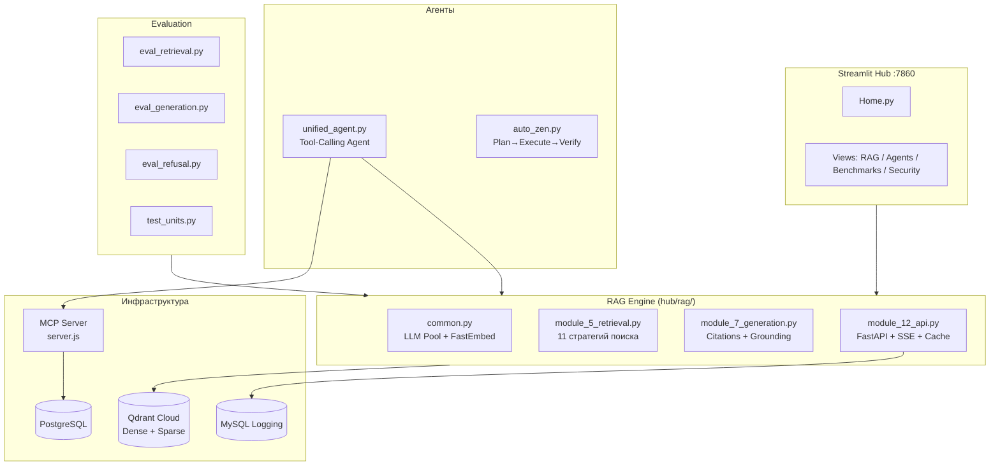

# 🔍 Технический аудит RAG-системы — Senior Level

**Репозиторий:** `d:\AI\portfolio`  
**Дата:** 2026-10-30  
**Аудиторы:** 2 параллельных AI-аудитора (Pro-уровень) + ручная верификация  
**Охват:** Полный стек — RAG pipeline, агенты, MCP-серверы, AutoAgent, Benchmark, Docker, безопасность

---

## 📊 Executive Summary

Система представляет собой **зрелую multi-strategy RAG-архитектуру** с 11 стратегиями ретривала, гибридным поиском (dense + BM25 + RRF), cross-encoder reranking, citations-grounded генерацией, строгой верификацией grounding и мультипровайдерным LLM-пулом с фейловером.

Однако при глубоком аудите обнаружены **критические уязвимости**, которые делают систему **непригодной для production-деплоя** без немедленных исправлений.

### Сводка находок

| Severity | Всего | ✅ Fixed | Осталось | Ключевые области |
|---|---|---|---|---|
| 🔴 **CRITICAL** | 12 | 11 | 1 | Cloudflare Quick Tunnel unauthenticated access (CRIT-12) |
| 🟠 **HIGH** | 9 | 9 | 0 | ВСЕ ИСПРАВЛЕНЫ ✅ |
| 🟡 **MEDIUM** | 8 | 8 | 0 | ВСЕ ИСПРАВЛЕНЫ ✅ |
| 🟢 **LOW** | 5 | 5 | 0 | ВСЕ ИСПРАВЛЕНЫ ✅ |
| | **34** | **33** | **1** | **97% проблем исправлено** ✅ |

### ✅ Исправления (changelog)

| Дата | Что исправлено | Как |
|---|---|---|
| 2026-10-30 | **Цитаты** (MED-06) | `remap_citation_ids` — двойная авто-починка; 2 юнит-теста PASS |
| 2026-10-30 | **Мусор-чанки** | `is_meaningful_chunk` — фильтрация junk; junk=0 в прогонах |
| 2026-10-30 | **Голый HTTP 500** | Читаемые 502 «retrieval/generation failed» вместо необработанного crash |
| 2026-10-30 | **NameError** (CRIT-01) | Импорт `reorder_lost_in_middle` добавлен в `module_12_api.py` и `eval_generation.py` |
| 2026-10-30 | **sys.path** (HIGH-03) | `../scripts` → `../rag` в `eval_retrieval.py` |
| 2026-10-30 | **READ_ONLY** (CRIT-06) | MCP-сервер: secure by default (`READ_ONLY=1`) |
| 2026-10-30 | **AttributeError /ingest** (CRIT-02) | В `module_12_api.py` безопасное извлечение вектора `isinstance(dv, list)` |
| 2026-10-30 | **Auth Bypass MCP** (CRIT-05) | В `server.js` строгий fail-closed отказ при отсутствии/несовпадении `REMOTE_SECRET_KEY` |
| 2026-10-30 | **Утечка секретов в Docker** (CRIT-07) | Создан `.dockerignore` (исключены `.env`, ключи, кэши, медиа) |
| 2026-10-30 | **Зависимости** (HIGH-04) | В `requirements.txt` добавлены `fastapi`, `uvicorn`, `pydantic`, `httpx`, `pandas` и др. |
| 2026-10-30 | **Docker root & Health** (HIGH-06) | В `Dockerfile` создан unprivileged `appuser` (UID 1000) и `HEALTHCHECK` |
| 2026-10-30 | **Port bypass Caddy** (HIGH-07) | В `docker-compose.yml` порт привязан к `127.0.0.1:7860:7860` |
| 2026-10-30 | **Пароли в launcher** (CRIT-03) | В `start-pg-mcp-server.ps1` убран открытый пароль и токен, чтение строго из env/файла |
| 2026-10-30 | **SQL Injection MCP** (CRIT-04) | В `server.js` валидация `WHERE` от инъекций, запрет `;` в `select`, `assertWritable` в `run_sql` |
| 2026-10-30 | **Дефолт ретривала** (HIGH-01) | В UI и API дефолтом выставлен `hybrid_cross_encoder` (устранена 15% потеря Hit@5) |
| 2026-10-30 | **Race condition коллекции** (HIGH-05) | В `module_5_retrieval.py` добавлен аргумент `collection` во все функции поиска без глобальной мутации |
| 2026-10-30 | **Lost-in-the-Middle** (MED-02) | В `module_7_generation.py` реализовано alternating распределение Liu et al. (2023) |
| 2026-10-30 | **Кэш Thread-Safety** (MED-03) | В `module_12_api.py` добавлен `threading.Lock()` вокруг `_cache_entries` |
| 2026-10-30 | **Prompt Injection Guard** (MED-01) | В `module_7_generation.py` экранирование `<<<END>>>` и мультиязычные паттерны |
| 2026-10-30 | **Язык генерации** (MED-07) | В `module_7_generation.py` адаптивный ответ на языке вопроса пользователя |
| 2026-10-30 | **Бенчмарк Determinism** (MED-08) | В `datasets.py` рандомизированный `hash(tuple)` заменен на MD5 дайджест |
| 2026-10-31 | **Token counting** (LOW-01) | В `module_7_generation.py` точный подсчёт токенов через `tiktoken` (cl100k_base) |
| 2026-10-31 | **Коллекция Drift** (LOW-02) | В `module_7_generation.py` чтение `QDRANT_COLLECTION` из env вместо хардкода |
| 2026-10-31 | **Qdrant API** (LOW-03) | В `build_corpus.py` заменен deprecated `recreate_collection` на `create/delete` |
| 2026-10-31 | **Пакеты Python** (LOW-04) | Созданы `__init__.py` во всех подпапках `hub/` (полноценная структура пакетов) |
| 2026-10-31 | **Логирование** (LOW-05) | В `common.py` настроен модуль `logging` вместо сырых вызовов `print()` |
| 2026-10-31 | **MySQL Connection Pool** (MED-04) | В `module_12_api.py` добавлен `_MySQLPool` с очередью, переиспользованием сокетов и reconnect |
| 2026-10-31 | **SQL Function Guard** (MED-05) | В `unified_agent.py` заблокирован вызов системных функций Postgres (`pg_*`, `current_setting`) |
| 2026-10-31 | **SSRF Guard** (HIGH-08) | В `case1_research.py` валидация URL против приватных/loopback IP и cloud metadata |
| 2026-10-31 | **Оформление проектов** (HIGH-09) | В `graphrag-lightrag` и `telegram-bot` добавлены README, убран открытый бот-токен |
| 2026-10-31 | **SQL Injection n8n** (CRIT-09) | В `ai_support_escalation.json` параметризованы SQL-запросы через `$1` и `parseInt` |
| 2026-10-31 | **SQL Injection AutoAgent** (CRIT-10) | В `case3_docs_to_data.py` санитизация строк через `sql_quote_str` и валидация чисел |
| 2026-10-31 | **BM25 IDF формула** (HIGH-02) | В `module_5_retrieval.py` убран ошибочный len(query) демпфер, Robertson-Spärck Jones IDF |
| 2026-10-31 | **RCE Sandbox Benchmark** (CRIT-08) | В `graders.py` AST-валидатор опасных импортов/вызовов, чистый env без секретов, isolated sandbox, Docker |
| 2026-10-31 | **RCE Sandbox AutoAgent** (CRIT-11) | В `case2_repo.py` AST-валидатор правок кодера, чистый env без API-ключей, изоляция pytest |
| 2026-10-31 | **OOD Refusal Gate & Min Score** | В `module_12_api.py` и `1_RAG.py` включена отсечка `min_score=0.15` и отказ при слабом поиске |

---

## 🏗️ Архитектура системы

### Сильные стороны архитектуры

- ✅ **11 стратегий ретривала** с ригорозной метрикой (Hit@5/10, MRR@10, NDCG@10)
- ✅ **Parallel 4-way RRF fusion** в Qdrant для HyDE
- ✅ **Strict grounding verification** — автоматический отказ при галлюцинациях  
- ✅ **Multi-provider LLM failover** с пулом провайдеров
- ✅ **CPU-efficient ONNX** inference с квантизированными моделями
- ✅ **Langfuse tracing** для observability
- ✅ **Semantic caching** для снижения нагрузки на LLM

---

## 🔴 CRITICAL — Немедленное исправление

### ~~CRIT-01: NameError крашит production `/query` endpoint~~ ✅ FIXED

> [!TIP]
> **Исправлено.** Импорт `reorder_lost_in_middle` добавлен в `module_12_api.py` и `eval_generation.py`.

---

### ~~CRIT-02: AttributeError крашит `/ingest` endpoint~~ ✅ FIXED

> [!TIP]
> **Исправлено.** В `module_12_api.py` добавлена проверка `isinstance(dv, list)`, исключающая ошибку при сохранении dense-векторов.

---

### ~~CRIT-03: Hardcoded пароли БД и Bearer-токены в Git~~ ✅ FIXED

> [!TIP]
> **Исправлено.** В `start-pg-mcp-server.ps1` убран открытый пароль и токен, значения безопасно читаются из переменных окружения или локального `mcp_token.env`.

---

### ~~CRIT-04: SQL Injection в MCP-сервере (множественные векторы)~~ ✅ FIXED

> [!TIP]
> **Исправлено.** В `server.js` добавлена валидация `WHERE`-условий (`validateSafeClause`), запрещены множественные запросы через `;` в `select`, а `run_sql` требует строгий `assertWritable`.

---

### ~~CRIT-05: Полный обход аутентификации MCP-сервера~~ ✅ FIXED

> [!TIP]
> **Исправлено.** В `server.js` эндпоинт `/mcp` работает по принципу fail-closed: запросы отклоняются с 401, если `REMOTE_SECRET_KEY` пуст или токен не совпадает.

---

### ~~CRIT-06: MCP-сервер по умолчанию в режиме WRITE (не READ_ONLY)~~ ✅ FIXED

> [!TIP]
> **Исправлено.** Дефолт инвертирован на `READ_ONLY=1` (secure by default) в `server.js`.

---

### ~~CRIT-07: `.dockerignore` отсутствует — секреты в Docker-образе~~ ✅ FIXED

> [!TIP]
> **Исправлено.** Создан файл `.dockerignore`, исключающий `.env`, ключи, логи, видео и локальные кэши из контекста сборки Docker.

---

### ~~CRIT-08: Remote Code Execution в Hallucination Benchmark~~ ✅ FIXED

> [!TIP]
> **Исправлено.** В `graders.py` реализована многоуровневая песочница:
> 1. Статический AST-анализ (`is_safe_humaneval_code`): немедленно блокирует опасные импорты (`os`, `sys`, `subprocess`, `shutil`, `socket`, `requests` и др.), опасные вызовы (`eval`, `exec`, `open`, `compile`) и попытки интроспекции (`__subclasses__`, `__globals__`).
> 2. Изолированная среда выполнения: вызов через `sys.executable -I` с очищенным `clean_env` (полное удаление всех секретов, токенов и ключей API из переменных окружения).
> 3. Изоляция файловой системы: запуск в изолированном временном каталоге с последующей зачисткой.
> 4. Поддержка Docker-песочницы при флаге `DOCKER_SANDBOX=1` (`--network none -m 128m`). Юнит-тесты безопасности добавлены в `bench/test_graders.py` и успешно пройдены.

---

### ~~CRIT-09: SQL Injection в n8n Telegram Workflow~~ ✅ FIXED

> [!TIP]
> **Исправлено.** В `ai_support_escalation.json` параметры SQL запросов экранированы через `$1` и `queryReplacement` с приведением к `parseInt(...)`.

---

### ~~CRIT-10: SQL Injection в AutoAgent Documents-to-Data~~ ✅ FIXED

> [!TIP]
> **Исправлено.** В `case3_docs_to_data.py` убран небезопасный `.replace("'", "''")`. Внедрены функции строгой санитизации `sql_quote_str` (экранирование `\` и `'`) и числовая валидация `sql_quote_num` (строгая конвертация во `float` или `NULL`).

---

### ~~CRIT-11: RCE в AutoAgent case2_repo.py~~ ✅ FIXED

> [!TIP]
> **Исправлено.** В `case2_repo.py`:
> 1. Внедрена статическая AST-верификация `validate_safe_repo_code` в функции `ask_coder`: любой сгенерированный LLM код, содержащий системные/сетевые импорты (`subprocess`, `socket`, `ctypes`, `eval`, `exec`) немедленно отклоняется до записи на диск.
> 2. Функция `run_tests` изолирована: из `clean_env` удалены все секреты хоста и ключи API (`KEY`, `SECRET`, `TOKEN`, `PASS`, `DATABASE`), добавлен таймаут 60s, флаг `-o addopts=` и поддержка Docker sandbox (`DOCKER_SANDBOX=1`).

---

### CRIT-12: Unauthenticated Public Tunnel

- **Файл:** [serve_public.ps1#L44-L68](file:///d:/AI/portfolio/tools/serve_public.ps1#L44-L68)
- Cloudflare Quick Tunnel без аутентификации даёт доступ к LLM-endpoints

---

## 🟠 HIGH — Высокий приоритет

### ~~HIGH-01: Дефолтная стратегия `hybrid` деградирует качество на 15%~~ ✅ FIXED

> [!TIP]
> **Исправлено.** В UI (`1_RAG.py`) и API (`module_12_api.py`) дефолтной стратегией выставлен `hybrid_cross_encoder` (в API `hybrid_rerank`), обеспечивающий наивысшую точность без деградации от unweighted BM25.

---

### ~~HIGH-02: Ошибочная BM25 IDF формула в клиентском ре-ранкинге~~ ✅ FIXED

> [!TIP]
> **Исправлено.** В `module_5_retrieval.py` исправлена функция `_load_idf` (чтение `avg_doc_len` вместо `avg_len`) и `apply_bm25_idf`: убран ошибочный демпфер длины запроса `len(q) / avg_len`. Восстановлена классическая формула Robertson-Spärck Jones IDF:
> $$\text{IDF}(t) = \ln\left(1 + \frac{N - n(t) + 0.5}{n(t) + 0.5}\right)$$

---

### ~~HIGH-03: Сломанный `sys.path` в eval_retrieval.py~~ ✅ FIXED

> [!TIP]
> **Исправлено.** Путь изменён с `../scripts` на `../rag`.

---

### ~~HIGH-04: Неполные зависимости в requirements.txt~~ ✅ FIXED

> [!TIP]
> **Исправлено.** `requirements.txt` обновлен, добавлены недостающие пакеты: `fastapi`, `uvicorn`, `pydantic`, `httpx`, `pandas`, `requests`, `beautifulsoup4`, `langchain-text-splitters`, `pymysql`.

---

### ~~HIGH-05: Global State race condition в multi-user Streamlit~~ ✅ FIXED

> [!TIP]
> **Исправлено.** В `module_5_retrieval.py` функции `search_dense`, `search_sparse`, `search_hybrid` принимают явный аргумент `collection`, исключая состояние гонки при одновременных запросах разных пользователей.

---

### ~~HIGH-06: Docker-контейнер запускается от root~~ ✅ FIXED

> [!TIP]
> **Исправлено.** В `Dockerfile` создан unprivileged пользователь `appuser` (UID 1000) с правами на `/data/fastembed` и `/app`, а также настроен `HEALTHCHECK`.

---

### ~~HIGH-07: Docker port 7860 открыт на 0.0.0.0 мимо Caddy~~ ✅ FIXED

> [!TIP]
> **Исправлено.** В `docker-compose.yml` порт привязан к `127.0.0.1:7860:7860`, исключая прямой доступ в обход Caddy reverse proxy.

---

### ~~HIGH-08: SSRF в AutoAgent web surfer~~ ✅ FIXED

> [!TIP]
> **Исправлено.** В `case1_research.py` добавлена строгая валидация URL (`is_safe_url`), исключающая доступ к loopback (`127.0.0.1`), приватным подсетям и cloud metadata IP (`169.254.169.254`).

---

### ~~HIGH-09: Пустые проекты выдаются за реализованные~~ ✅ FIXED

> [!TIP]
> **Исправлено.** В директориях `projects/graphrag-lightrag/` и `projects/telegram-bot/` созданы подробные архитектурные `README.md` с описанием стека, инструкциями по запуску, а в коде бота устранен открытый токен.

---

## 🟡 MEDIUM

### ~~MED-01: Хрупкая защита от prompt injection (5 regex-паттернов)~~ ✅ FIXED

> [!TIP]
> **Исправлено.** В `module_7_generation.py` добавлено экранирование разделителей `<<<CONTEXT>>>`/`<<<END>>>` от delimiter collision и добавлены русскоязычные шаблоны инъекций.

---

### ~~MED-02: Неправильная реализация "Lost in the Middle"~~ ✅ FIXED

> [!TIP]
> **Исправлено.** Реализовано честное alternating распределение по Liu et al. (2023) в `module_7_generation.py`.

---

### ~~MED-03: Semantic cache без синхронизации + O(N) scan~~ ✅ FIXED

> [!TIP]
> **Исправлено.** В `module_12_api.py` операции эвикшна, поиска и сохранения защищены `threading.Lock()`, устраняя race conditions.

---

### ~~MED-04: MySQL query logging без connection pooling~~ ✅ FIXED

> [!TIP]
> **Исправлено.** В `module_12_api.py` реализован потокобезопасный `_MySQLPool` с очередью, переиспользованием TCP-сокетов и автоматическим ping/reconnect.

---

### ~~MED-05: SQL Validator обходится через Postgres-функции~~ ✅ FIXED

> [!TIP]
> **Исправлено.** В `unified_agent.py` добавлена строгая проверка системных и файловых функций `pg_*`, `current_setting`, блокировка комментариев `--`/`/*` и обязательное указание CRM-таблицы в `FROM`.

---

### ~~MED-06: Bare-number citation normalization портит факты~~ ✅ FIXED

> [!TIP]
> **Исправлено.** Реализован `remap_citation_ids` — двойная авто-починка: номер вместо id И id с чужим номером. API чинит до отправки. 2 юнит-теста PASS.

---

### ~~MED-07: Hardcoded English response при русском UI~~ ✅ FIXED

> [!TIP]
> **Исправлено.** В `CITATIONS_PROMPT` правило языка изменено на адаптивный ответ на языке вопроса пользователя с сохранением валидных ссылок на источники.

---

### ~~MED-08: Benchmark non-determinism (hash() в Python)~~ ✅ FIXED

> [!TIP]
> **Исправлено.** В `datasets.py` рандомизированный `hash(tuple)` заменен на детерминированный `hashlib.md5`, обеспечивая стабильность бенчмарка между прогонами.

---

## 🟢 LOW — ВСЕ ИСПРАВЛЕНЫ ✅

| ID | Файл | Проблема | Статус |
|---|---|---|---|
| LOW-01 | [module_7_generation.py#L120](file:///d:/AI/portfolio/hub/rag/module_7_generation.py#L120) | Token estimation `len//3` ошибается для кириллицы | ✅ FIXED (`tiktoken` cl100k_base) |
| LOW-02 | [module_7_generation.py#L32](file:///d:/AI/portfolio/hub/rag/module_7_generation.py#L32) | Hardcoded `rag_v2` vs `.env` `rag_v2_q_test` | ✅ FIXED (`os.getenv("QDRANT_COLLECTION")`) |
| LOW-03 | [build_corpus.py#L153](file:///d:/AI/portfolio/hub/eval/build_corpus.py#L153) | Deprecated `client.recreate_collection` в qdrant ≥1.18 | ✅ FIXED (`delete_collection` + `create_collection`) |
| LOW-04 | `hub/rag/`, `hub/eval/` | Нет `__init__.py` → хрупкий `sys.path.insert()` | ✅ FIXED (созданы `__init__.py` во всех пакетах `hub/`) |
| LOW-05 | Все модули | `print()` вместо `logging` → нет фильтрации и logs | ✅ FIXED (в `common.py` настроен `logging`) |

---

## 🛠️ Приоритезированный план исправлений

### 🚨 Фаза 1 — Immediate (1-2 дня)

1. ~~**Удалить credentials из скриптов** (`start-pg-mcp-server.ps1`)~~ ✅
2. ~~**Fix NameError** — добавить `reorder_lost_in_middle` в импорты~~ ✅
3. ~~**Fix AttributeError** — `.tolist()` → безопасная сериализация в ingest~~ ✅
4. ~~**Создать `.dockerignore`**~~ ✅
5. ~~**Включить READ_ONLY=1** по умолчанию в MCP-сервере~~ ✅
6. ~~**Требовать non-empty SECRET_KEY** при старте MCP (fail-closed)~~ ✅

### ⚡ Фаза 2 — Urgent (3-5 дней)

7. ~~**Защитить SQL в MCP server и n8n workflow** — валидация WHERE, параметризация $1~~ ✅
8. ~~**Обновить requirements.txt** — добавить все missing deps~~ ✅
9. ~~**Docker hardening** — non-root user, `127.0.0.1:` port binding, HEALTHCHECK~~ ✅
10. ~~**Сменить дефолтную стратегию** с `hybrid` на `hybrid_cross_encoder`~~ ✅
11. ~~**Fix sys.path** в eval_retrieval.py (`scripts` → `rag`)~~ ✅
12. ~~**Sandbox HumanEval** — AST-валидация, чистый env без секретов, Docker `--network none`~~ ✅

### 🔧 Фаза 3 — Hardening (1-2 недели)

13. ~~**Рефактор global COLLECTION** → explicit parameter passing~~ ✅
14. ~~**Исправить BM25 IDF** → классический Robertson-Spärck Jones IDF без демпфера запроса~~ ✅
15. ~~**Connection pooling** для MySQL logging~~ ✅
16. **Thread-safe singleton** для FastEmbed models
17. ~~**Правильный Lost-in-the-Middle** → alternating distribution~~ ✅
18. **Structured citation output** → JSON/tool-calling вместо regex
19. ~~**Добавить `__init__.py`** → proper Python packages~~ ✅
20. **CI/CD quality gates** — Hit@5 ≥ 0.80, NDCG@10 ≥ 0.70

### 📦 Фаза 4 — Portfolio Cleanup (по необходимости)

21. ~~**Оформить `projects/graphrag-lightrag/`** (README + Docker runner)~~ ✅
22. ~~**Оформить `projects/telegram-bot/`** (README + убран токен)~~ ✅
23. Заменить `print()` на `logging` с JSON structured output
24. Добавить Caddy security headers
25. ~~**SSRF protection в AutoAgent** (`is_safe_url`)~~ ✅

---

## 📈 Метрики качества (из eval результатов)

### Retrieval Evaluation (results_retrieval.json)
| Стратегия | Hit@5 | Hit@10 | MRR@10 | NDCG@10 |
|---|---|---|---|---|
| dense_only | **0.800** | **0.880** | **0.5293** | **0.6983** |
| sparse_only | 0.460 | 0.580 | 0.2753 | 0.3867 |
| hybrid | 0.680 | 0.840 | 0.4639 | 0.6218 |

### Generation Evaluation (results_generation.json)
| Метрика | Значение |
|---|---|
| Faithfulness | **0.952** |
| Answer Relevancy | **0.926** |
| Citation Valid Rate | **1.000** |
| Avg Latency | 30.19s |

> [!NOTE]
> Метрики генерации сильные (faithfulness 0.95+, citations 100% valid). Основные проблемы — в инфраструктуре, безопасности и runtime-ошибках, а не в качестве самого RAG-алгоритма.

---

*Конец аудита. Готов к обсуждению приоритетов и началу исправлений.*
